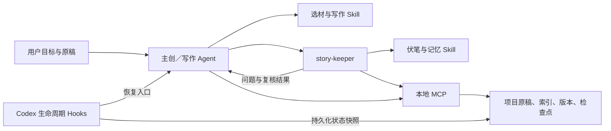

# 架构与职责

主创负责用户沟通、选材、正文和实质修改。守护者读取正文、维护必要的状态、定位证据、审查回收与连续性；不修改正文。MCP 没有正文写入工具，守护角色关闭 shell 与内置 memories 功能；角色指令仍需遵守宿主权限，不能被描述成独立安全沙箱。

Skill 给 Agent 非机械的专业方法，包括来源用途、类型化诊断、人物策略、对白和伏笔。MCP 固定的部分是文件边界、版本、存取和证据存在性；它不计算“剧本优秀分数”，不抽取或决定语义记忆，不做向量检索。

持久化索引以原稿为依据。约束、人物、信息、规则、决定等记录可扩展，原稿通过 ID、hash、场次和短引定位。新任务只取相关记录和原稿，避免把全季材料反复塞入上下文。聊天摘要、旧检查点与旧原稿不能覆盖新版本。

多 Agent 使用相同 project_root，更新必须带 expected_revision。并发写入有锁和版本冲突保护。每次有效修改保留历史并使旧审查失效；只有当前语义审查及证据闭环都通过才能定稿。

生命周期有三层验证：纯函数事件检查、真实 MCP 连接、宿主实际事件。不能因为测试主动调用了 hook 函数，就宣称 Codex 已在真实自动压缩时加载并信任该 hook。

MCP 使用标准 stdio JSON-RPC，运行时只依赖 Node.js 内置模块。兼容清单从 portable plugin.json 与 mcp.json 派生，避免维护两套不同身份或版本。
